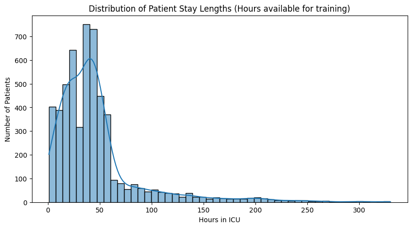
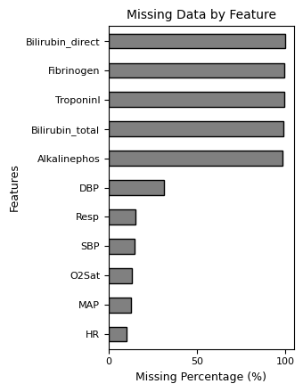
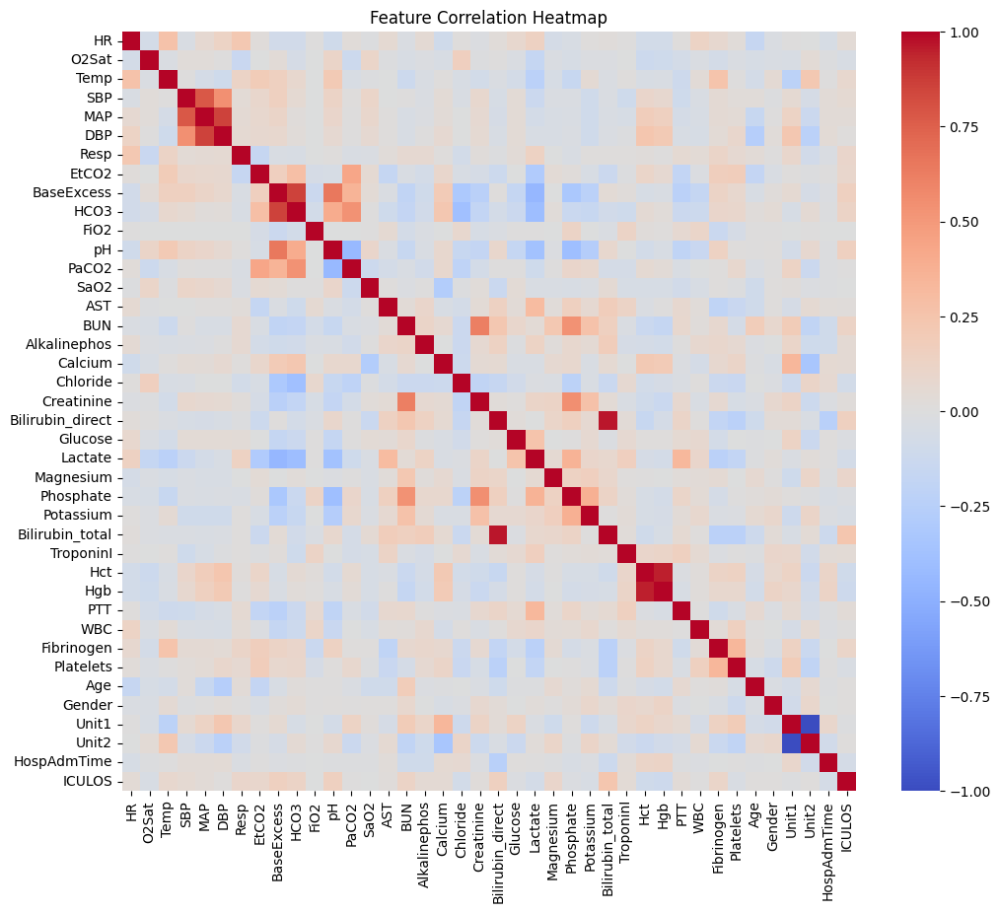
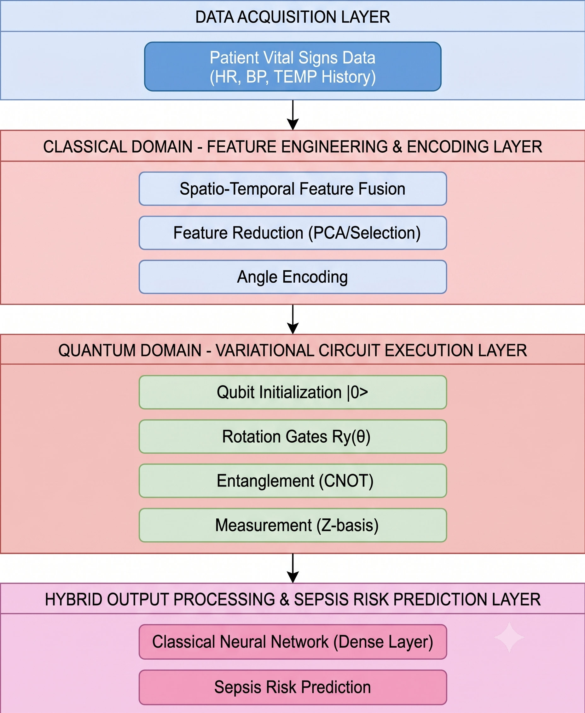

# Quantum Sepsis Prediction with a Lightweight Hybrid Quantum–Classical Model

 **Research code repository** for a resource-conscious hybrid quantum–classical machine-learning framework for **early sepsis prediction from ICU time-series data**, with an emphasis on a compact model and potential edge-deployment scenarios.

> **Publication:** Published at CINS 2026, organized at BITS Pilani, Dubai.  
> **Paper:** [WILL BE UPDATED] 
> **Project origin:** Developed as part of the *Digital Healthcare and AI* subject.

---

## Overview

Sepsis is a time-critical condition in which early recognition can be difficult because deterioration may appear gradually across vital signs and laboratory measurements. This project investigates whether a compact hybrid quantum–classical model can learn patterns of physiological deterioration from sequential ICU data.

The pipeline processes hourly patient observations, applies clinically informed labeling and preprocessing, forms overlapping temporal windows, and feeds the windows into a hybrid model. A small classical adapter compresses the selected temporal information into four values, which are processed by a parameterized quantum circuit. Quantum measurements are then passed to a classical classification head to produce a sepsis-risk score.

The design explores **predictive performance alongside model compactness, latency, and memory footprint**, making resource efficiency an important focus for potential edge deployment.

---

## Exploratory Data Analysis (EDA)

EDA was conducted to understand the ICU dataset, the length of patient records, missingness across clinical features, and relationships between variables.

### 1. Patient Stay Lengths

The distribution of patient record lengths (measured in available hourly observations) helps characterize how much temporal information is available per patient. Stay length is important when creating fixed-size temporal windows and when considering how many training samples each patient can contribute.



### 2. Percentage of Missing Values per Feature

ICU datasets often contain substantial missingness because measurements are not collected uniformly or continuously. Missing-value percentages were examined for individual features to understand data sparsity and inform preprocessing.



### 3. Feature Correlation Heatmap

The correlation heatmap was used to inspect linear relationships between numerical variables, identify correlated measurements, and better understand the relationships within the physiological and laboratory feature space.



---

## Data Processing Pipeline

### 1. Clinical Labeling

The original sepsis labels are shifted to create an early-warning target:

- Hours from **3 hours before the recorded sepsis onset through the onset hour** are marked positive.
- The preceding **3–6-hour interval** is excluded from training to reduce ambiguity around the transition.
- Remaining eligible observations are retained as non-positive training observations.

This creates a target focused on detecting patterns close to sepsis onset while excluding an ambiguous transition interval.

### 2. Missing-Value Imputation

Features are imputed patient-wise to avoid using values from other patients:

1. Forward-fill within each patient.
2. Backward-fill remaining gaps within the same patient.
3. Use the patient's feature mean as a fallback for values still missing.

### 3. Clinical and Temporal Feature Engineering

The model uses the original vital signs and laboratory features along with derived features.

**Base features (15):**

- HR, O2Sat, Temp
- SBP, MAP, DBP, Resp
- pH, PaCO2
- BUN, Creatinine, Lactate
- WBC, Platelets, Age

**Derived features:**

- **Shock Index:** HR / SBP
- **Modified Shock Index:** HR / MAP
- **6-hour change features:** HR, MAP, Resp, Shock Index, and Modified Shock Index

The change features capture how measurements evolve over time rather than relying only on their current values.

> Note: Pulse Pressure (SBP − DBP) is computed during preprocessing in the notebook, but it is not included in the final `ALL_FEATURES` list used by the model as some experiments showed they were'nt contributing much in predicting sepsis labels.

### 4. Temporal Windowing

Hourly observations are converted into overlapping fixed-length windows.

| Setting | Value |
|---|---:|
| Window length | 12 hours |
| Stride | 6 hours |
| Overlap | 6 hours |
| Maximum windows per patient during balanced training | 16 |

Each sample contains **12 hours of clinical measurements**. The stride of 6 hours means a new window begins every 6 hours, allowing overlapping windows to capture evolving patient physiology.

A window is labeled positive if at least one hour within it has the shifted positive label.

During balanced training, the pipeline also applies a signal-change filter and limits the number of windows contributed by each patient, then balances the positive and negative window counts.

---

## Model Architecture

The proposed model is a compact **hybrid quantum–classical architecture**.



### Architecture Components

#### 1. Temporal State Selection

From each 12-hour window, the model selects:

- The current state: features from the last hour of the window.
- A past state: features from 6 hours earlier (the `x[:, -7, :]` position in the implementation).

The difference between the current and past states is calculated to represent temporal change.

#### 2. Temporal Feature Fusion

The two representations are concatenated:

- Current features
- Current-minus-past features

This provides the model with both the present physiological state and a representation of how it changed over the preceding six hours.

#### 3. Classical Adapter

A fully connected linear layer maps the fused representation (44 values for the 22-feature configuration) to **4 values**, corresponding to the four quantum circuit inputs.

This adapter acts as a compact feature projection before quantum processing.

#### 4. Quantum Circuit

The quantum component uses:

| Quantum setting | Value |
|---|---:|
| Qubits | 4 |
| Variational layers | 1 |
| Circuit simulator | PennyLane `default.qubit` |
| Input encoding | Angle embedding |
| Trainable circuit | Strongly Entangling Layers |
| Measurements | Pauli-Z expectation values on each qubit |

The four adapter outputs are encoded into the quantum circuit. A parameterized entangling layer then transforms the quantum state, and the circuit returns four expectation values.

#### 5. Classical Classification Head

The four quantum measurement outputs are passed through a linear classification layer that produces a single logit. Applying the sigmoid function to the logit gives the predicted sepsis probability.

### Model Flow

```text
12-hour ICU window
        │
        ├── Current state (last hour)
        │
        └── Past state (6 hours earlier)
                    │
       Current state + temporal difference
                    │
          Classical Linear Adapter
               44 → 4
                    │
            4-Qubit Circuit
           Angle Embedding
                    │
       Strongly Entangling Layer
                    │
       Pauli-Z Expectation Measurements
                 (4 values)
                    │
        Classical Classification Head
                 4 → 1
                    │
           Sepsis-Risk Logit
                    │
              Sigmoid
                    │
        Predicted Sepsis Probability
```

---

## Training Strategy

### Loss Function

The training objective combines weighted binary cross-entropy and focal loss:

- **Weighted BCE:** increases the importance assigned to positive sepsis samples.
- **Focal loss:** emphasizes harder-to-classify examples and reduces the contribution of easy examples.

The combined loss is:

\[
\mathcal{L} = \alpha \mathcal{L}_{\mathrm{BCE}} + (1-\alpha)\mathcal{L}_{\mathrm{Focal}}
\]

The implementation uses `POS_WEIGHT = 2.0` and `ALPHA = 0.2`.

### Patient-Level Splitting

To reduce patient leakage:

- A 20% patient-grouped hold-out test set is reserved.
- The remaining development data is used to train five models with grouped cross-validation.
- Patients are kept separate across the group-based splits.

### Ensemble

Five trained models are retained. At inference time, each model generates a probability for a test window, and the probabilities are averaged to produce the final ensemble prediction.

Each model's scaler statistics are retained and used when preparing the inference data for that model.

---

## Benchmarking

The hybrid model was benchmarked against classical machine-learning and deep-learning approaches, including:

- LSTM
- CNN
- Transformer
- XGBoost
- Classical Micro-MLP

The benchmarking focuses on predictive performance as well as model resource requirements. The reported parameters, model size, inference latency, and memory footprint help assess whether a compact model may be more suitable for resource-constrained environments than larger alternatives.

### Benchmark Results

| Model | AUROC | Parameters | Model Size (MB) | Latency (ms) | Memory (MB) |
|---|---:|---:|---:|---:|---:|
| LSTM | 0.65 | 14,401 | 0.05 | 0.031 | 495 |
| CNN | 0.68 | 29,121 | 0.11 | 0.028 | 375 |
| Transformer | 0.70 | 69,249 | 0.26 | 0.134 | 657 |
| **Q-Sepsis** | **0.99** | **197** | **0.00075** | **0.011** | **93.75** |

The reported benchmark shows Q-Sepsis with the highest AUROC among the compared models while also having the smallest parameter count, model size, latency, and memory footprint in this table.

- **Parameter count:** Q-Sepsis uses 197 parameters, substantially fewer than the compared architectures.
- **Model size:** the reported size is 0.00075 MB.
- **Latency:** the reported inference latency is 0.011 ms.
- **Memory footprint:** the reported memory usage is 93.75 MB.

These results highlight the compactness and resource-efficiency of the proposed model under the benchmarking setup.

> **Edge deployment focus:** The compact parameter count, low reported latency, and reduced memory footprint motivate the model's potential suitability for resource-constrained and edge-oriented settings. The results presented here are benchmarking measurements and should not be interpreted as completed deployment or validation on dedicated edge hardware unless such testing has been performed.

---

## Results

The following metrics were reported for the proposed model.

### Performance Metrics

| Metric | Result |
|---|---:|
| Accuracy | 96% |
| Recall | 0.84 |
| Precision | 0.69 |
| F1 Score | 0.76 |
| AUROC | 0.99 |
| AUPRC | 0.85 |

### Interpretation

- **Accuracy (96%)** — Overall proportion of predictions classified correctly.
- **Recall (0.84)** — The model identifies 84% of positive samples under the reported evaluation threshold.
- **Precision (0.69)** — Among the samples predicted positive, 69% are positive under the evaluation labels.
- **F1 Score (0.76)** — Harmonic balance between precision and recall.
- **AUROC (0.99)** — Indicates strong ranking discrimination between positive and negative samples under the reported evaluation.
- **AUPRC (0.85)** — Summarizes precision–recall performance and is particularly relevant when positive cases are relatively rare.

Together, the reported results indicate strong predictive discrimination while maintaining a compact architecture with low resource requirements in the benchmarking environment.

---

## Edge-Deployment Motivation

Early sepsis prediction is valuable in environments where continuous patient monitoring and timely alerts are important. A compact model can be attractive when computational resources, memory, or infrastructure are constrained.

The project explores this direction through:

- A very small trainable parameter count.
- A compact classical adapter and classification head.
- A small quantum circuit with four qubits and one variational layer.
- Low reported inference latency and memory usage in the benchmark.
- A prediction pipeline based on a fixed temporal window and selected clinical features.

These characteristics make the model a candidate for further investigation in edge-oriented healthcare systems. Actual deployment would require additional validation on target hardware, including measurement of end-to-end latency, power consumption, reliability, privacy constraints, and integration with clinical monitoring workflows.

THE CITATION DETAILS WILL BE AVAILABLE SOON
